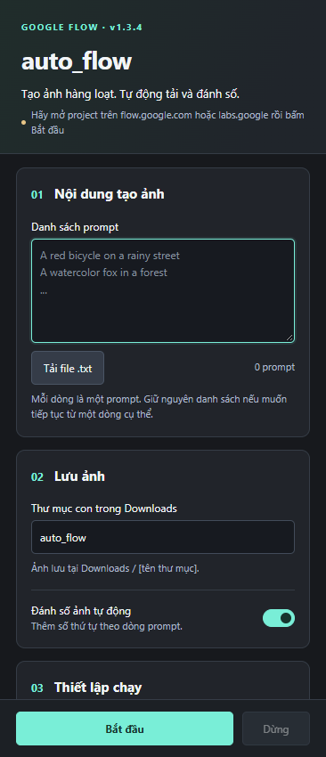

# auto_flow

**Tự động tạo ảnh hàng loạt trên Google Flow, tải ảnh và đánh số theo từng prompt.**

auto_flow là tiện ích Chrome mở trong bảng bên, giúp quản lý danh sách prompt, gửi theo nhóm và lưu ảnh vào thư mục bạn chọn trong Downloads. Tiện ích sử dụng phiên đăng nhập Flow hiện có, không cần nhập API key.

- **Phiên bản:** 1.3.4
- **Nền tảng:** Google Chrome 118 trở lên · Manifest V3
- **Trạng thái:** Thử nghiệm — đã kiểm tra bằng dữ liệu mô phỏng; chưa xác nhận luồng tạo và tải ảnh trên tài khoản Flow thật.

## Giao diện

Giao diện nền xám than, điểm nhấn xanh ngọc, gồm bốn nhóm: **Nội dung tạo ảnh**, **Lưu ảnh**, **Thiết lập chạy** và **Hàng đợi**. Nút **Bắt đầu / Dừng** luôn nằm ở đáy bảng bên khi cuộn.



## Tính năng

- Nhập trực tiếp danh sách prompt hoặc tải từ file `.txt`, mỗi dòng một prompt.
- Gửi theo nhóm từ **1–10 prompt**; hoàn thành nhóm hiện tại trước khi chuyển sang nhóm tiếp theo.
- Ghép phản hồi tạo ảnh với đúng prompt, không cần chờ thẻ ảnh hiển thị trên trang.
- Tự tải ảnh, đặt tên theo prompt và thêm số thứ tự tùy chọn.
- Tiếp tục từ một dòng trong danh sách, giữ số thứ tự tương ứng.
- Thiết lập khoảng nghỉ ngẫu nhiên giữa các lần gửi.
- Theo dõi trạng thái tạo ảnh, tải ảnh và lỗi trong hàng đợi.
- Tự thử lại khi nhận được lỗi máy chủ tạm thời mà tiện ích nhận diện được.
- Lưu danh sách prompt và các cài đặt chính trong trình duyệt.

## Cài đặt

1. Tải mã nguồn bằng **Code → Download ZIP** trên GitHub, rồi giải nén vào một thư mục cố định.
2. Mở `chrome://extensions` trong Chrome.
3. Bật **Developer mode / Chế độ dành cho nhà phát triển**.
4. Chọn **Load unpacked / Tải tiện ích đã giải nén**.
5. Chọn thư mục chứa trực tiếp file `manifest.json`.
6. Ghim **auto_flow** trên thanh công cụ để mở bảng bên thuận tiện hơn.
7. Nếu đang mở Flow, tải lại tab trước khi sử dụng.

## Sử dụng

### 1. Chuẩn bị trên Flow

- Đăng nhập Google Flow và mở project cần tạo ảnh.
- Chọn chế độ **Image thông thường**, tắt Agent và đặt **1 ảnh / prompt**.
- Chọn model, tỉ lệ ảnh trên Flow trước khi chạy.
- Đợi các tác vụ cũ hoàn thành và đóng DevTools (F12).

### 2. Nhập nội dung

Mở bảng bên **auto_flow**, dán danh sách vào **Danh sách prompt** hoặc chọn **Tải file .txt**.

```text
A red bicycle on a rainy street
A watercolor fox in a forest
A cozy cabin beside a lake at sunrise
```

Mỗi dòng không trống được tính là một prompt. Các prompt giống hệt nhau trong một nhóm được gửi tuần tự để tránh nhầm kết quả.

### 3. Chọn nơi lưu và cách chạy

| Cài đặt | Ý nghĩa |
| --- | --- |
| Thư mục con trong Downloads | Thư mục nhận ảnh; mặc định là `auto_flow`. |
| Đánh số ảnh tự động | Thêm tiền tố như `001_`, `002_` theo vị trí prompt. |
| Bắt đầu từ prompt số | Chạy từ dòng đã chọn trong danh sách; mặc định là `1`. |
| Số prompt mỗi nhóm | Từ 1 đến 10; mặc định là 10. |
| Nghỉ giữa các lần gửi | Khoảng nghỉ tính bằng giây; `0–0` để gửi liên tiếp trong nhóm. |

Lần đầu sử dụng, thử **2–3 prompt**, chọn **1 prompt mỗi nhóm** và nghỉ **3–5 giây** để kiểm tra với tài khoản của bạn.

### 4. Bắt đầu và theo dõi

Bấm **Bắt đầu**, theo dõi trạng thái tại **Hàng đợi**. Giữ tab Flow và bảng bên mở; không tạo ảnh thủ công hoặc đổi project trong lúc chạy.

Chrome sẽ hiển thị thanh thông báo tiện ích đang gỡ lỗi trình duyệt. Đây là cơ chế tiện ích dùng để nhập prompt và đọc phản hồi tạo ảnh; giữ thanh này khi đang chạy.

- **Kiểm tra kết quả:** đọc lại kết quả đã nhận, không gửi lại prompt.
- **Dừng:** ngừng gửi thêm và ngừng chờ trong tiện ích. Tác vụ đã gửi vẫn có thể tiếp tục trên Flow.

Ảnh được lưu tại `Downloads/[tên thư mục con]`. Tên file lấy từ prompt đã loại bỏ ký tự không hợp lệ; phần mở rộng được điều chỉnh theo loại ảnh tải về. Có thể đổi vị trí Downloads trong cài đặt Chrome.

### Tiếp tục công việc đang dở

1. Kiểm tra ảnh đã tải và các tác vụ còn chạy trên Flow.
2. Nạp lại **toàn bộ danh sách prompt ban đầu**.
3. Nhập dòng cần tiếp tục vào **Bắt đầu từ prompt số**.
4. Bấm **Bắt đầu**.

Ví dụ: nhập `41` để chạy từ prompt thứ 41. Khi bật đánh số, ảnh tương ứng bắt đầu bằng `041_`. Dòng trống không được tính. Tiện ích không tự dò ảnh đã có để quyết định dòng bắt đầu.

## Giới hạn

- Chỉ hỗ trợ tạo ảnh thông thường với **1 ảnh / prompt**; chưa hỗ trợ Agent, video hoặc nhiều ảnh cho một prompt.
- Không tự đồng bộ ảnh tham chiếu, không xuất dự án Premiere hoặc CapCut.
- Việc đăng nhập, CAPTCHA, quyền truy cập và hạn mức vẫn do Flow xử lý.
- Tiện ích phụ thuộc giao diện và định dạng phản hồi của Flow; thay đổi từ phía Flow có thể khiến tiện ích cần cập nhật.
- Khi mất dấu tác vụ hoặc không nhận diện được phản hồi, tiện ích dừng gửi thêm để tránh tạo trùng. Ảnh có thể vẫn đã được tạo trên Flow.
- Lỗi tạo ảnh tạm thời được thử lại với khoảng chờ tăng dần từ 5 đến 60 giây; việc thử lại có thể tiếp tục cho đến khi thành công hoặc bạn bấm Dừng.
- Nếu ảnh đã tạo nhưng tải xuống thất bại, tiện ích không tự tạo lại ảnh đó.

## Khắc phục sự cố

| Hiện tượng | Cách xử lý |
| --- | --- |
| Chưa kết nối được Flow | Mở project có ô nhập prompt, tải lại tab và mở lại bảng bên. Nếu có nhiều project, chọn tab muốn chạy. |
| Phản hồi không nhận diện hoặc bị ngắt | Kiểm tra ảnh trên Flow, lưu thủ công nếu cần và ghi lại dòng prompt cùng thông báo lỗi. |
| Lỗi đăng nhập, quyền truy cập hoặc hạn mức | Kiểm tra và xử lý trực tiếp trên Flow trước khi tiếp tục. |
| Ảnh đã tạo nhưng chưa tải được | Kiểm tra Downloads và tải ảnh thủ công từ Flow; tránh gửi lại cùng prompt ngay. |

## Quyền truy cập và dữ liệu

| Quyền | Mục đích |
| --- | --- |
| `sidePanel` | Hiển thị giao diện trong bảng bên Chrome. |
| `downloads` | Lưu ảnh, đặt tên và kiểm tra trạng thái tải xuống. |
| `storage` | Lưu prompt, cài đặt và thông tin phục vụ theo dõi tải xuống. |
| `tabs` | Tìm và chọn tab project Flow. |
| `scripting` | Nạp mã tương tác vào tab Flow khi cần. |
| `debugger` | Nhập prompt và theo dõi yêu cầu/phản hồi tạo ảnh của tab. |

Phạm vi trang được khai báo: `https://labs.google/*`, `https://flow.google/*` và `https://flow.google.com/*`.

Danh sách prompt và các cài đặt chính được lưu bằng `chrome.storage.local`. Prompt được gửi đến Flow trong phiên đăng nhập hiện tại để tạo ảnh; ảnh được tải về qua Chrome.
